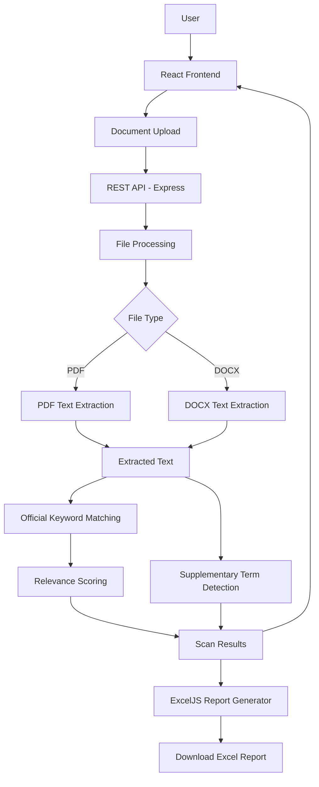

# ScopeLens
### Tender & Scope-of-Work Relevance Scanner for Tritorc

**ScopeLens** is a full-stack web application designed to automate the initial screening of tender and Scope-of-Work (SOW) documents for relevance to Tritorc's industrial bolting and related services.

The application allows users to upload multiple PDF and DOCX documents, extract their text, identify relevant keywords, calculate document relevance, and export the results into a structured Excel report.

By automating keyword-based document screening, ScopeLens helps reduce the effort involved in manually reviewing multiple tender documents.

## Live Application

- **Frontend:** https://scope-lens-jet.vercel.app
- **Backend API:** https://scopelens-backend.onrender.com
- **Backend Health Check:** https://scopelens-backend.onrender.com/api/health
- **GitHub Repository:** https://github.com/Samiyakhan456/ScopeLens

The application is deployed using Vercel for the frontend and Render for the backend. Its core upload, extraction, matching, scoring, and Excel export workflows have been tested.

---

## 1. System Architecture

ScopeLens follows a client-server architecture consisting of a React frontend and a Node.js/Express backend.

### Architecture Diagram



### Processing Workflow

1. **Document Upload:** Users upload multiple PDF or DOCX files through the React interface.
2. **Text Extraction:** The backend extracts document content using `pdf-parse` and `mammoth`.
3. **Keyword Matching:** Extracted text is checked against the configured Tritorc keyword list using case-insensitive phrase matching and simple plural variations.
4. **Relevance Scoring:** Documents are classified according to the number of distinct official keywords matched.
5. **Supplementary Term Detection:** Additional industrial terminology is identified and reported separately from the official keyword score.
6. **Excel Generation:** The results are compiled into a downloadable Excel report using ExcelJS.

### Relevance Classification

| Distinct official keyword matches | Classification |
|---|---|
| 0 | Not Related |
| 1–2 | Possibly Related |
| 3 or more | Related |

Supplementary terminology does not contribute to the official relevance score.

---

## 2. Technologies Used

| Component | Technology |
|---|---|
| Frontend | React, Vite |
| Styling | CSS |
| Backend | Node.js, Express.js |
| API Communication | REST API, Fetch API |
| PDF Extraction | pdf-parse |
| DOCX Extraction | Mammoth |
| Keyword Processing | JavaScript |
| Excel Generation | ExcelJS |
| Keyword Configuration | CSV, JSON |
| Version Control | Git, GitHub |
| Frontend Hosting | Vercel |
| Backend Hosting | Render |

---

## 3. Installation Instructions for Users

### Prerequisites

- Node.js installed
- npm installed
- Git installed

### Step 1: Clone the Repository

```bash
git clone https://github.com/Samiyakhan456/ScopeLens.git
cd ScopeLens
```

### Step 2: Install Backend Dependencies

```bash
cd server
npm install
```

### Step 3: Configure the Backend

Create a `.env` file inside the `server` directory:

```env
PORT=5000
```

### Step 4: Start the Backend

```bash
npm start
```

The backend runs at:

```text
http://localhost:5000
```

### Step 5: Install Frontend Dependencies

Open a separate terminal from the project root:

```bash
cd client
npm install
```

Create a `.env` file inside the `client` directory:

```env
VITE_API_URL=http://localhost:5000
```

### Step 6: Start the Frontend

```bash
npm run dev
```

Open the local URL displayed by Vite, usually:

```text
http://localhost:5173
```

The application is now ready to use.

---

## 4. Installation Instructions for Developers

### Repository Structure

```text
ScopeLens/
│
├── client/
│   ├── public/
│   └── src/
│       ├── assets/
│       ├── components/
│       ├── pages/
│       ├── services/
│       └── styles/
│
├── server/
│   ├── config/
│   │   ├── keywords.csv
│   │   └── relatedTerms.json
│   │
│   ├── controllers/
│   │   └── scanController.js
│   │
│   ├── routes/
│   │   └── scanRoutes.js
│   │
│   └── services/
│       ├── docxExtractor.js
│       ├── excelGenerator.js
│       ├── keywordMatcher.js
│       ├── pdfExtractor.js
│       ├── relatedTermMatcher.js
│       ├── relevanceScorer.js
│       ├── testMatcher.js
│       ├── testPDF.js
│       └── testScorer.js
│
├── .gitignore
├── AI_NOTES.txt
├── DEPLOY.md
└── README.md
```

### Backend Development

The backend is built using Express.js and follows a modular structure:

- `config/`: Stores official keywords and supplementary terminology.
- `controllers/`: Handles document scanning requests.
- `routes/`: Defines API endpoints.
- `services/`: Contains document extraction, keyword matching, relevance scoring, and Excel generation logic.

Start the backend in development mode:

```bash
cd server
npm install
npm run dev
```

### Frontend Development

The frontend is built using React and Vite.

Its main responsibilities include:

- Document upload and validation.
- Displaying scan results.
- Presenting matched keywords and relevance classifications.
- Providing Excel report downloads.

Start the frontend development server:

```bash
cd client
npm install
npm run dev
```

### Environment Variables

| File | Variable | Description |
|---|---|---|
| `server/.env` | `PORT` | Backend server port |
| `client/.env` | `VITE_API_URL` | Backend API base URL |

Keep environment files private and never commit actual secrets to GitHub.

### API Endpoints

| Method | Endpoint | Description |
|---|---|---|
| POST | `/api/scan` | Upload and scan documents, returning analysis results |
| POST | `/api/scan/excel` | Process uploaded documents and generate an Excel report |
| GET | `/api/health` | Check backend service availability |

---

## 5. Contributor Expectations

Contributions and improvements are welcome.

If you would like to contribute:

1. Fork the repository.
2. Create a separate branch for your changes.
3. Follow the existing folder structure and coding conventions.
4. Keep official keyword matching and supplementary terminology detection logically separate.
5. Verify that changes do not break PDF/DOCX extraction or Excel generation.
6. Test your changes before submitting a pull request.
7. Provide a clear description of the changes made.

Please avoid committing environment variables, API secrets, confidential tender documents, or generated reports.

---

## 6. Known Issues and Limitations

- **Keyword-based matching:** Relevance scoring relies on configured keywords rather than contextual semantic understanding.
- **Simple variations:** The matcher supports case-insensitive phrase matching and simple plural variations, but does not implement full linguistic stemming or fuzzy semantic matching.
- **Document extraction:** Extraction quality depends on the text available in the uploaded document. Scanned PDFs requiring OCR are not currently supported by the implemented extraction workflow.
- **Supplementary terminology:** Additional industrial terms are reported separately and do not contribute to the official Tritorc relevance score.
- **Upload limits:** The application currently supports up to 10 files per request, with a maximum file size of 10 MB per file.

---

## 7. Future Improvements

Potential areas for further development include:

- OCR support for scanned PDF documents.
- Semantic similarity and contextual relevance detection.
- Advanced linguistic matching and terminology expansion.
- Expanded automated testing.
- Production logging, error monitoring, and performance improvements.

---

**ScopeLens — Automating the first stage of tender relevance screening.**